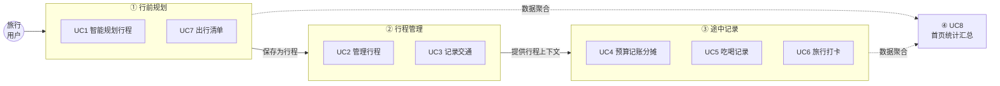
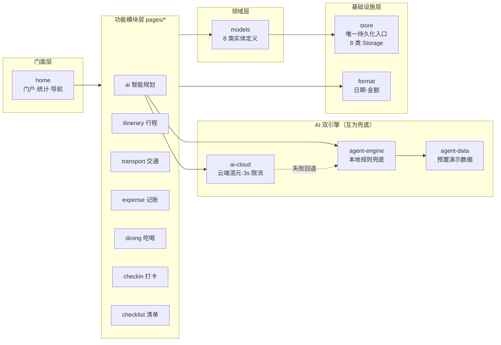
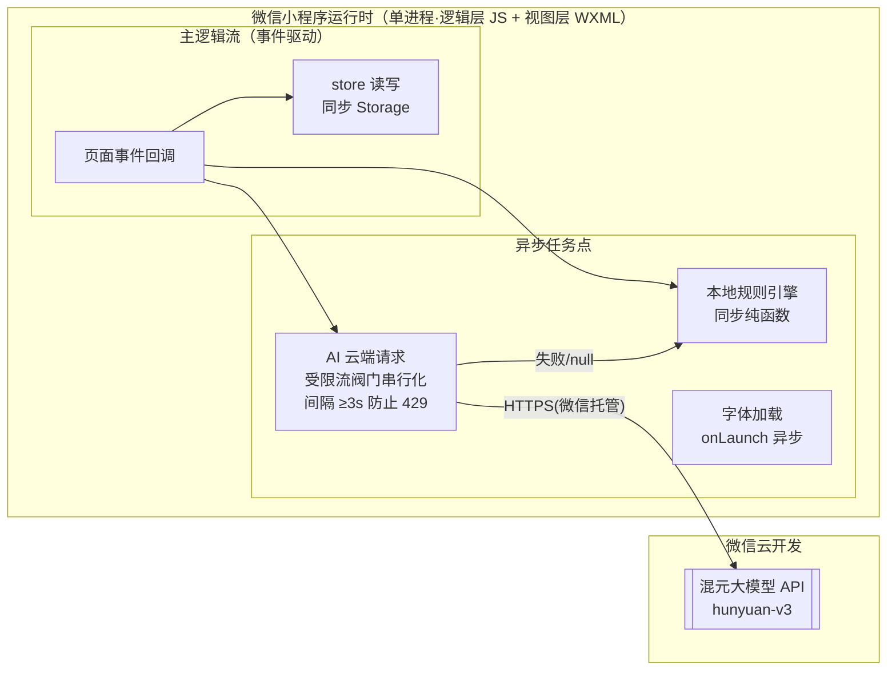
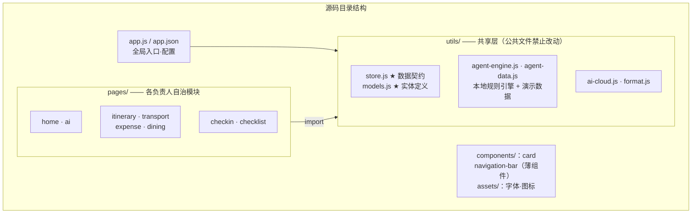
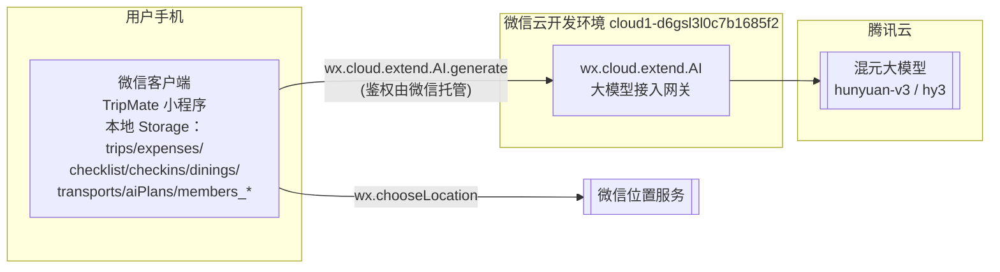

# TripMate 软件架构 "4+1" 视图

> 4 + 1 = 逻辑视图 + 进程视图 + 开发视图 + 物理视图，由 **场景视图** 统领。
> 所有视图围绕核心场景展开：*自然语言输入 → AI 生成行程方案 → 保存为行程 → 途中记账/交通/打卡/清单/吃喝记录 → 首页汇总统计*。

## 0. 场景视图（+1，Use Case View）

**关键场景走查（驱动其余 4 个视图）**：

| 步骤 | 动作 | 涉及模块 |
|---|---|---|
| 1 | 用户在 AI 页输入"帮我规划上海 3 日游" | `pages/ai` → `utils/ai-cloud.js` |
| 2 | 云端混元大模型生成方案；失败/限流则回退本地规则引擎 | `utils/agent-engine.js`（兜底） |
| 3 | 用户可修改方案并保存为正式行程 | `pages/ai` → `pages/itinerary` |
| 4 | 途中记账、记交通、打卡、勾清单、记吃喝（均挂到行程） | 各 `pages/*` → `utils/store.js` |
| 5 | 首页展示行程数/总花费/打卡数/清单进度 | `pages/home` |

---

## 1. 逻辑视图（Logical View）— 功能模块分解

要点：
- **分层**：门面（home）→ 功能模块 → AI 双引擎 / 领域模型 → 持久化与工具。
- **AI 双通道**：云端混元（`wx.cloud.extend.AI`）为主，本地纯函数规则引擎兜底，保证离线/限流可用。
- **组件极薄**：`components/card`、`components/navigation-bar` 仅为占位，非核心构件。

---

## 2. 进程视图（Process View）— 运行时控制流

要点：
- **单进程、单包小程序**，无多线程/多进程；并发模型 = 事件循环 + 异步回调（Promise）。
- **并发控制点**：AI 云端请求用全局 3 秒间隔阀门串行化，避免触发力率限制。
- **降级路径**：云端返回 `null` 时同步回退本地规则引擎，用户无感。
- 数据读写为同步 `wx.setStorageSync`（统一收敛在 `store.js`），无异步数据竞争。

---

## 3. 开发视图（Development View）— 代码组织与团队分工

要点：
- **团队协作约定**（各页面 js 顶部注释 + `checklist/README.md`）：每人只改自己的 `pages/<模块>/`；公共文件（`store.js`、`models.js` 等）只读不改；禁止绕过 `store.js` 直调 `wx.setStorageSync`。
- **纯原生小程序**，无 npm 依赖、无构建工具链；页面 = 模块 = 分工单元。
- 遗留物（仅文档记录，图中已省略）：`pages/index` 空壳页、`mock.js` 停用开关，可在重构中移除；`ai.js` 中存在指向不存在 map 页的死链接。

---

## 4. 物理视图（Physical View）— 部署拓扑

要点：
- **无自建服务器、无云函数、无云数据库** —— 所有业务数据仅存于设备本地 Storage，换机/卸载即丢失（当前最重要的架构限制）。
- 云端仅承担一件事：混元大模型生成行程方案。
- 隐私权限：仅声明 `chooseLocation`（打卡选点）。

---

## 附：视图间追溯

| 场景（+1） | 逻辑 | 进程 | 开发 | 物理 |
|---|---|---|---|---|
| AI 规划行程 | `pages/ai` + 双引擎 | 云端请求限流 + 本地兜底 | `ai-cloud.js`/`agent-engine.js`（公共层） | 云开发 AI 网关 ↔ 混元 |
| 记账/打卡/清单 | 各功能模块 + `models.js` | 同步 Storage 读写 | 各负责人 `pages/*` 自治 | 纯本地存储 |
| 首页汇总 | `pages/home` 聚合 | 页面 onShow 时读取 | 仅读 `store.js` 契约 | 本地 Storage |
